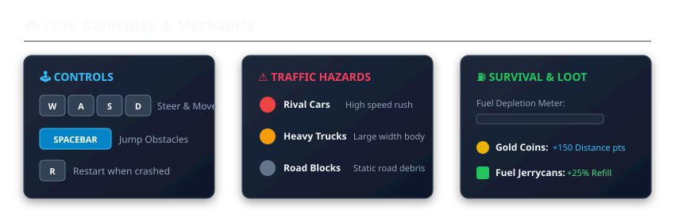

<div align="center">

# 🏎️ NoCtraX: Vehicle Survival Mini Game


<br/>

[](https://www.python.org/)
[](https://www.pygame.org/)
[](https://github.com/)
[](LICENSE)
[](#)

<p align="center">
  <b>A fast-paced, retro 2D highway survival game built in Python using Pygame.</b><br>
  Dodge incoming traffic, leap over roadblocks with jump physics, harvest fuel cans to keep going, and collect shiny gold coins to push for the highest survival score!
</p>

[🕹️ Play Game](#-quick-start) • [✨ Features](#-game-features) • [🎮 Controls](#-controls--hotkeys) • [⚙️ Mechanics](#-game-mechanics-breakdown) • [📦 Installation](#-installation--setup)

</div>

---

## 📸 Gameplay & Mechanics Overview



---

## ✨ Game Features

- 🏎️ **Dynamic Jump Mechanics**: Hit `SPACEBAR` to leap into the air over incoming traffic and roadblocks, powered by custom gravity physics and mid-air shadows.
- 🚦 **Intelligent Procedural Traffic**: Obstacles spawn dynamically across 3 lanes, featuring sports cars, heavy trucks, and stationary road blocks.
- ⚡ **Progressive Speed Scaling**: As distance grows, the highway scroll speed and enemy vehicle velocity increase smoothly, demanding quicker reflexes.
- ⛽ **Fuel Depletion & Supply Drops**: Your tank drains steadily over time. Collect green fuel cans to refill your tank before it hits empty and your engine dies.
- 🪙 **Gold Coin Multipliers**: Collect shiny coins placed along the highway to boost your score by `+150` points each.
- 🛡️ **Fair Landing Grace Period**: Includes a 12-frame collision grace buffer upon landing so you won't instantly crash from close proximity calls.
- 🎵 **Modular Audio Pipeline**: Built-in sound effects for jumping, collecting coins, refueling, and crashes with auto-detection that gracefully runs in silent mode if no audio device is connected.
- 🌲 **Scenic Parallax Landscape**: Procedurally generated checkerboard grass terrain, road borders, trees, and roadside boulders.

---

## 🎮 Controls & Hotkeys

| Key Binding | Action | Description |
| :--- | :--- | :--- |
| <kbd>W</kbd> or <kbd>▲ Up Arrow</kbd> | **Accelerate Forward** | Move car up the screen |
| <kbd>S</kbd> or <kbd>▼ Down Arrow</kbd> | **Brake / Reverse** | Pull car backward toward the bottom |
| <kbd>A</kbd> or <kbd>◄ Left Arrow</kbd> | **Steer Left** | Navigate toward the left lanes |
| <kbd>D</kbd> or <kbd>► Right Arrow</kbd> | **Steer Right** | Navigate toward the right lanes |
| <kbd>SPACEBAR</kbd> | **Jump** | Leap into the air to jump over rival vehicles |
| <kbd>R</kbd> | **Restart Game** | Instantly restart a new run after a Game Over |
| <kbd>ESC</kbd> / Window Close | **Quit** | Exit game gracefully |

---

## ⚙️ Game Mechanics Breakdown

### 1. Parabolic Jump Physics
Unlike traditional 2D car games, your racer can launch itself into the air:
$$\text{velocity}_{\text{initial}} = -18, \quad \text{gravity} = 1.2$$
- While airborne (`on_ground == False`), your car's collision hitbox is deactivated against obstacles.
- A dynamic drop-shadow is rendered beneath the car on the asphalt to give accurate visual depth.
- Once touching down, `landing_grace = 12` frames prevent collision bugs.

### 2. Hazard Classifications
```
   [ Red Sports Car ]       [ Heavy Orange Truck ]      [ Concrete Roadblock ]
   Compact & Rapid          Wide hitbox, slower         Stationary obstruction
   Speed: 4-7 + boost       Speed: 4-7 + boost          Speed: world scroll
```

### 3. Fuel & Survival Economy
- Fuel begins at **100%**.
- Fuel burn formula:
  $$\Delta \text{Fuel} = 0.03 + (\text{World Speed} \times 0.002)$$
- Collecting a **Fuel Can** restores **+25%** fuel.
- If fuel reaches **0%**, engine starvation triggers an instant **Game Over**.

### 4. Scoring Algorithm
$$\text{Score} = \left\lfloor \frac{\text{Distance Traveled}}{10} \right\rfloor + (150 \times \text{Coins Collected})$$

---

## 📦 Installation & Setup

### Prerequisites
Make sure you have **Python 3.8** or higher installed on your system.
Verify by opening your terminal or command prompt:
```bash
python --version
```

### 1. Clone the Repository
```bash
git clone https://github.com/RanithuDewage/YOUR_REPOSITORY_NAME.git
cd YOUR_REPOSITORY_NAME
```

### 2. Create a Virtual Environment (Recommended)
```bash
# Windows
python -m venv venv
venv\Scripts\activate

# macOS / Linux
python3 -m venv venv
source venv/bin/activate
```

### 3. Install Dependencies
```bash
pip install -r requirements.txt
```
*(Or install Pygame directly: `pip install pygame`)*

### 4. Launch the Game
```bash
python Game.py
```

---

## 🔊 Audio Customization (Optional)

The game includes automatic audio loading with silent fallback protection. To enable full audio effects, simply place the following sound files in the root folder alongside `Game.py`:

| Filename | Format | Purpose |
| :--- | :--- | :--- |
| `jump.wav` | WAV audio | Played whenever you press Spacebar to jump |
| `coin.wav` | WAV audio | Played upon collecting a golden coin |
| `fuel.wav` | WAV audio | Played upon picking up a green fuel can |
| `crash.wav` | WAV audio | Played when crashing or running out of fuel |
| `bgm.ogg` | OGG audio | Continuous looping background soundtrack |

*Note: If these files are absent, the game runs completely normally without crashing.*

---

## 📂 Project Structure

```plaintext
├── assets/
│   ├── banner.svg           # High-resolution animated SVG title banner
│   └── gameplay.svg         # Animated visual controls & mechanics diagram
├── Game.py                  # Main game engine loop, sprites, & physics
├── requirements.txt         # Project dependencies (Pygame)
├── .gitignore               # Ignored build, cache, and system files
└── README.md                # Project documentation & manual
```

---

## 🛠️ Code Architecture

The game is designed with an object-oriented sprite architecture:

- **`Player`**: Encapsulates position vectors, lane constraints, jump gravity offsets, and custom hitbox boundaries.
- **`Obstacle`**: Handles random lane generation, sprite type selection (car, truck, block), and dynamic vertical velocity.
- **`Coin` / `FuelCan`**: Timed sprite spawners for positive reward loops.
- **`Decor`**: Manages roadside trees and rocks for continuous parallax scrolling.
- **`new_game()`**: Clean state reset handler used at startup and upon pressing `R`.

---

## 🤝 Contributing

Contributions, bug reports, and feature requests are welcome!
Feel free to check the [Issues page](https://github.com/RanithuDewage/YOUR_REPOSITORY_NAME/issues).

1. Fork the Project
2. Create your Feature Branch (`git checkout -b feature/AmazingFeature`)
3. Commit your Changes (`git commit -m 'Add some AmazingFeature'`)
4. Push to the Branch (`git push origin feature/AmazingFeature`)
5. Open a Pull Request

---

## 📄 License

Distributed under the **MIT License**. See `LICENSE` for more information.

---

<div align="center">

Crafted with ❤️ by **Ranithu Dewage**

⭐ If you enjoy this project, don't forget to give it a star on GitHub! ⭐

</div>
